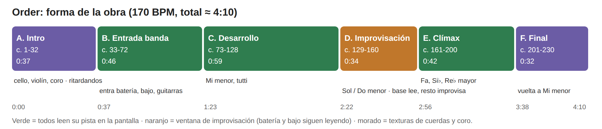
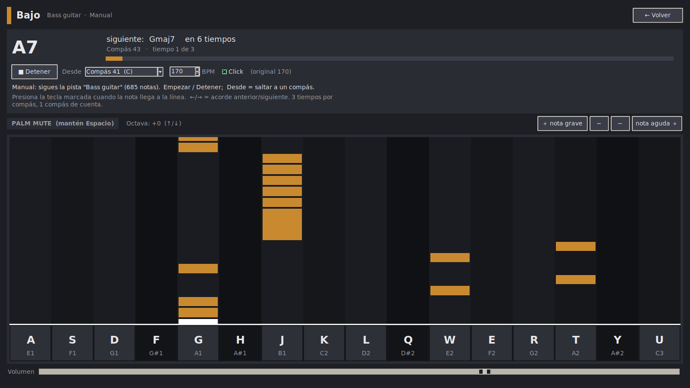
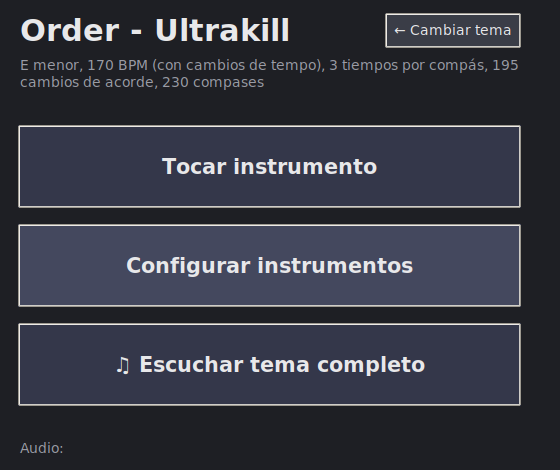
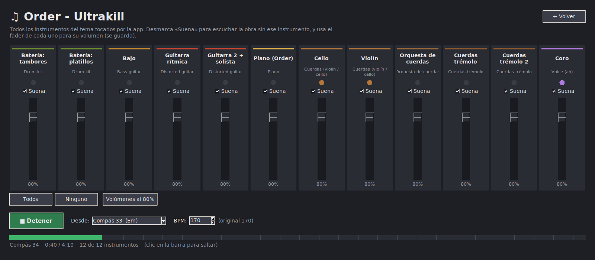

# T1: Propuesta de obra: *Order*, para orquesta de laptops

**Alvaro** · IEE2003 Orquesta de Laptops UC · 2.º semestre 2026 · Prof. Rodrigo F. Cádiz

**Material:**

- **App (código):** repositorio [github.com/Ikilly0/ORQUESTRA-DE-LAPTOS](https://github.com/Ikilly0/ORQUESTRA-DE-LAPTOS).
- **Render (75 s):** `render/render-order.wav` y `render/render-order.mp3`.
- **Documentación de uso:** en la Parte 3 de este documento.

---

## Parte 1: Contexto y referentes

### 1. *CliX*, Ge Wang (2006), para la Princeton Laptop Orchestra (PLOrk)

**Por qué se eligió:** en CliX los intérpretes **improvisan y tocan directamente**. Cada sonido nace de una tecla que una persona presiona en ese momento; no se reproduce nada pregrabado. Es lo que se busca para la obra propuesta.

**Qué hace.**
- **Qué se escucha:** según la ficha de SLOrk, «cada tecla del teclado del computador (mayúsculas, minúsculas, números, símbolos) corresponde a una altura distinta (usando su representación ASCII)». Al presionarla, emite un clic «sincronizado en el tiempo con un pulso común».
- **Qué sucede en escena:** las personas teclean y las máquinas sintetizan, sincronizan y espacializan el audio.
- **Idea musical:** que **teclear sea tocar**.
- **Estreno:** mayo de 2006, en *PLOrk in the Round* (Princeton). La página de Ge Wang la describe «para 15 laptops».

**Cómo está construida.**
- **Arquitectura técnica:** está programada en ChucK, y el código se publica en la ficha de la obra. En PLOrk, cada estación era un «meta-instrumento» con laptop y parlante hemisférico propio de seis canales (Trueman et al., 2006).
- **Coordinación:** tiene dos capas.
  - **Máquina:** los clics se alinean a un pulso común.
  - **Persona:** un **director humano** que «coordina registro, textura, movimiento y tiempo».
- **Forma e instrucciones:** no hay partitura. La forma la construye el director en vivo sobre la improvisación de todos.
- **Roles:** todos tocan el mismo instrumento y se diferencian por lo que el director pide.

**Qué es aplicable a mi propuesta.**
- **Sí:** se toma el **teclado del computador como instrumento**, que es la interfaz garantizada del ensamble. También se toma que **cada sonido lo toque una persona en vivo**, que haya un **director que coordina con gestos** y una **ventana de improvisación** (la sección D de la obra).
- **No:** no se toma el mapeo ASCII, porque las teclas se ordenan de grave a agudo, como un piano, para que se puedan leer. Tampoco se toma la sincronización automática al pulso: en esta obra el ritmo lo pone la persona.

**Fuentes consultadas.**
- SLOrk, «CliX (2006)»: [slork.stanford.edu/works/clix](https://slork.stanford.edu/works/clix).
- G. Wang, página de investigación: [cs.princeton.edu/~gewang/research](https://www.cs.princeton.edu/~gewang/research/).
- D. Trueman, P. Cook, S. Smallwood y G. Wang, «PLOrk: The Princeton Laptop Orchestra, Year 1», ICMC 2006: [slork.stanford.edu/readings/vault/2006-icmc-plork.pdf](https://slork.stanford.edu/readings/vault/2006-icmc-plork.pdf).
- Grabación: [vimeo.com/197854007](https://vimeo.com/197854007).

### 2. *Freesia*, Daisuke Ishiwatari, de *Guilty Gear Xrd -Revelator-* (Arc System Works, 2015-2016)

**Por qué se eligió:** es del **género más familiar para el autor**, el rock y metal de videojuegos, y **tiene piano**, su instrumento preferido.

**Qué hace.**
- **Qué es:** un tema vocal de la banda sonora de *Guilty Gear Xrd -Revelator-*, de 5:24.
- **Créditos:** música de Daisuke Ishiwatari, letra de Ishiwatari y Junya C. Motomura, voz de Naoki Hashimoto y arreglo de Norichika Sato.
- **Uso en el juego:** suena **en los créditos del modo historia (Episode Mode)**.
- **Estilo:** la serie *Guilty Gear* es conocida por su música rock y metal, y el tema aparece etiquetado como *metal* y *video game music*.
- **Versión de trabajo:** un MIDI de piano solo, una reinterpretación de 5:17 con 2.648 notas.

**Cómo está construida.** Análisis del MIDI de piano, hecho con el analizador de la app:
- **Tonalidad:** Mi mayor, con una correlación de 0,93 con el perfil de Krumhansl. Las notas más usadas son E, B, G#, A, F#, C# y D#, es decir, la escala de Mi mayor.
- **Regiones tonales** (ventanas de 20 s): casi todo en Mi mayor. Hay zonas que tiran a Si mayor, la dominante (≈ 60-80 s y 220-260 s), y a Do# menor, la relativa (≈ 140-160 s).
- **Métrica:** el MIDI está escrito en 4/4 a 104 BPM, pero la grilla está corrida un tercio de tiempo. Al corregirla, el bajo marca un **compás de 3 tiempos**, a unos 209 BPM, o 105 contados a medio tiempo.
- **Armonía:** 183 compases y 159 cambios de acorde, casi uno por compás. Predominan acordes mayores, menores, séptimas de dominante y m7.
- **Textura del piano:**
  - La mano izquierda (C#1-B3) lleva el bajo y los acordes.
  - La mano derecha (C4-C#7) lleva la melodía y los arpegios.
  - Una sola persona hace el papel de toda la banda.
- **Coordinación y roles** (en el original): es una canción de banda con voz. La coordinación es la de un grupo de rock: batería como pulso y roles fijos de voz, guitarras, bajo, batería y teclados.

**Qué es aplicable a mi propuesta.**
- **Sí:**
  - El **formato de banda repartido en roles** (bajo, guitarras, piano, batería, voz o coro), que es justo el de *Order*.
  - El **piano** como instrumento propio de una estación.
  - El **análisis armónico por compás** de *Freesia*, que se convirtió en la parte de la app que muestra el **acorde actual y el siguiente** mientras se toca.
- **No:**
  - *Freesia* es **una sola pista de piano**, así que no se puede repartir entre 7 a 12 estaciones sin inventar el arreglo. Por eso la obra es *Order*, que tiene 12 pistas.
  - La **voz solista**: ninguna estación canta, y el coro es sintetizado («ah»).

**Fuentes consultadas.**
- The Guilty Gear Wiki, «Freesia»: [guiltygear.wiki.gg/wiki/Freesia](https://guiltygear.wiki.gg/wiki/Freesia).
- Wikipedia, «Guilty Gear Xrd»: [en.wikipedia.org/wiki/Guilty_Gear_Xrd](https://en.wikipedia.org/wiki/Guilty_Gear_Xrd).
- Last.fm, ficha del tema en el *Original Sound Track*: [last.fm](https://www.last.fm/music/%E7%9F%B3%E6%B8%A1%E5%A4%AA%E8%BC%94/Guilty+Gear+Xrd+-Revelator-+Original+Sound+Track/Freesia).
- Análisis del MIDI: `song.py` de la app.

---

## Parte 2: Propuesta de obra: *Order*

### 1. Título provisorio e idea

**Título provisorio: *Order*, para orquesta de laptops.**

La propuesta es que el ensamble toque en vivo, a mano, un tema completo de banda repartido entre todas las laptops.

- **El tema:** **ORDER**, de Heaven Pierce Her. Es un tema del videojuego **ULTRAKILL**, publicado en el álbum *ULTRAKILL: CHAOS/ORDER* (2021), la banda sonora de sus misiones secretas. El arreglo es un MIDI de **12 pistas**, transcrito y reinterpretado por el autor: cello, violín, orquesta de cuerdas, dos capas de cuerdas en trémolo, coro, piano, bajo, dos guitarras distorsionadas y batería.
- **Fuente del tema:** Heaven Pierce Her, *ULTRAKILL: CHAOS/ORDER*, en Bandcamp: [heavenpierceher.bandcamp.com](https://heavenpierceher.bandcamp.com/album/ultrakill-chaos-order).
- **Cómo se toca:** cada estación es un instrumento de esa banda y lo **toca nota por nota con el teclado** del computador. Para eso se hizo una app en la que la pantalla muestra las notas que vienen, cayendo hacia un teclado dibujado. **Nada se reproduce solo:** si una estación no toca, su voz no existe.
- **Relación con *CliX*:** de CliX se toma el teclado como instrumento, un director que coordina y una ventana de **improvisación** (sección D), donde cada uno toca lo que decide.
- **Relación con *Freesia*:** de Freesia se toma el género (metal y orquesta de videojuego), el formato de banda repartido en roles, el piano y el análisis armónico que guía a los intérpretes.

### 2. Estructura formal

La forma sigue las secciones del tema, obtenidas del análisis del MIDI: qué pistas suenan y qué acordes hay en cada tramo. La sección D se agregó para dar espacio a la improvisación.

| Sección | Compases | Duración (170 BPM) | Qué sucede | Paso a la siguiente |
| --- | --- | --- | --- | --- |
| **A. Intro** | 1-32 | ≈ 0:37 | Cello, violín y coro. El tempo tiene ritardandos escritos en el MIDI, en los compases 2-4. | Ritardando en los compases 32-36 y entra la banda. |
| **B. Entrada de la banda** | 33-72 | ≈ 0:46 | Entran la batería, el bajo, las guitarras, la orquesta y los trémolos, en Mi menor. | Continuo. |
| **C. Desarrollo** | 73-128 | ≈ 0:59 | Riff de guitarra rítmica, bajo y batería, con trémolos y orquesta. Desde el compás 97 se suman el violín y la guitarra 2. | Continuo. Al final, el director levanta la mano abierta: se viene la improvisación. |
| **D. Improvisación** | 129-160 | ≈ 0:34 | Episodio en Sol menor y Do menor. **La batería y el bajo siguen leyendo**, así que la base se mantiene. **El resto improvisa** con sus teclas, guiado por el acorde que muestra la pantalla y los gestos del director. | En el compás 160, puño cerrado del director: todos vuelven a leer en el 161. |
| **E. Clímax** | 161-200 | ≈ 0:42 | Toda la banda. Modulación a Fa, Si♭ y Re♭ mayor, y el solo de guitarra (compases 166-197). | Continuo. |
| **F. Final** | 201-230 | ≈ 0:32 | Vuelta a Mi menor y cierre. | Última nota sostenida. El director corta. |

**Total ≈ 4:10** a 170 BPM, a partir de la duración real del MIDI. Si el director pide repetir la sección D, se reinicia desde el compás 129 con una cuenta y la obra dura ≈ 4:45. Tocada al 75 % del tempo (botón de la app), dura ≈ 5:30.

### 3. Estrategia de coordinación

**Sin red.** La coordinación es **humana**, apoyada en la pantalla de cada estación:

1. **Mismo punto de partida.** Todas las estaciones eligen el mismo **tempo (BPM)** y el mismo punto **Desde** en la app. Los puntos de partida están cada 8 compases e indican su acorde.
2. **Cuenta del director.** El director (estación de piano) cuenta con la mano «3, 2, 1» y todos presionan **Empezar** a la vez. La app da **un compás de cuenta** con clic y la música empieza en el tiempo 1.
3. **Escucha mutua durante la obra.** La **batería es el reloj audible**. La pantalla guía, pero manda el oído. El clic queda activado solo en la estación de batería.
4. **Si alguien se pierde,** usa **← / →** para saltar al acorde anterior o siguiente y reengancharse, sin detener a los demás.
5. **Si se pierde todo el ensamble,** el director detiene la obra con el puño cerrado, anuncia el siguiente punto **Desde** y vuelve a contar.
6. **Gestos del director en la sección D:** son los que sirven para improvisar (ver punto 5).

**Red:** no se usa. Como mejora futura, la estación del director podría enviar por OSC, con el protocolo `/oluc`, un mensaje de inicio (`/oluc/order/start compas bpm`) y uno por compás (`/oluc/order/compas n`). Si un mensaje se pierde, la estación sigue con su propio reloj. Sin red, la obra se toca exactamente como se describe arriba.

### 4. Roles por estación

Cada estación **toca en vivo** su pista. Tiene que decidir y ejecutar en tiempo real:

- **Tocar a tiempo** las notas que caen.
- **Técnicas:**
  - *palm mute*, manteniendo Espacio;
  - *power chords*, con Enter;
  - cambio de **octava**, con ↑/↓;
  - **agregar o quitar notas** a su teclado, con los botones «+ nota grave» y «+ nota aguda».
- **Improvisar** en la sección D.

El **modo automático** de la app, en el que la app toca la pista, es **solo para practicar**. En el concierto nadie lo usa.

**Estaciones:**

| # | Estación | Qué toca | Qué decide o ejecuta en vivo | Carga (notas por segundo, promedio del tema) |
| --- | --- | --- | --- | --- |
| 1 | **Batería: tambores** | Bombo, bombo 2, caja y toms | Es el **pulso de todos**. En la sección D sigue leyendo y decide los rellenos. | Alta (8,8) |
| 2 | **Batería: platillos** | Hi-hat, ride y crash | Completa la batería. En la sección D sigue leyendo y decide los acentos. | Alta (8,9) |
| 3 | **Bajo** | Fundamentales | Es la base armónica. En la sección D sigue leyendo; puede sostener una nota pedal. | Media (2,7) |
| 4 | **Guitarra rítmica** | Riffs graves | *Palm mute* y *power chords* en vivo. Improvisa en la sección D. | Media-alta (4,5) |
| 5 | **Guitarra 2 + solista** | Las dos guitarras del MIDI, unidas porque se turnan | Lleva el **solo** de los compases 166-197. Improvisa en la sección D. | Media (2,0) |
| 6 | **Piano (director)** | Pocas notas | **Dirige**: cuenta, entradas y gestos de la sección D. Toca cuando no está dirigiendo. | Baja (0,4) |
| 7 | **Violín** | Melodía de cuerdas | Abre la obra (sección A). Improvisa en la sección D. | Baja (1,1) |
| 8 | **Cello** | Línea grave de cuerdas | Abre la obra con el violín. Improvisa en la sección D. | Media (1,6) |
| 9 | **Orquesta de cuerdas** | Colchón armónico | Sostiene los acordes. En la sección D, notas largas. | Baja (1,2) |
| 10 | **Coro** | Notas largas | Aparece en la intro. En la sección D, notas largas sobre el acorde. | Baja (0,5) |
| 11 | **Cuerdas trémolo** | Textura de trémolo | Improvisa en la sección D. | Baja (0,4) |
| 12 | **Cuerdas trémolo 2** | Segunda capa de trémolo | Improvisa en la sección D. | Media (2,0) |

La obra funciona **con cualquier número de intérpretes entre 7 y 12**. Las pistas que no tienen estación simplemente no suenan: el arreglo se adelgaza, pero el tema se mantiene mientras estén la batería, el bajo y las guitarras.

### 5. Notación e instrucciones de ejecución

- **Toda la obra se nota en pantalla.** Cada estación ve su pista como **notas que caen** hacia su teclado:
  - una columna por tecla, de grave (izquierda) a agudo (derecha);
  - la nota se toca cuando llega a la línea blanca;
  - el largo del bloque indica cuánto se mantiene.
- **Arriba, la pantalla muestra** el **acorde actual**, el **siguiente** y en cuántos tiempos cambia, además del compás.

**Boceto completo: sección D, Improvisación** (compases 129-160, ≈ 0:34)

*Acordes, en compases de 3 tiempos, tal como los muestra la pantalla de cada estación:*

| Compases | Acordes |
| --- | --- |
| 129-136 | E♭ · Gm · Gm · E♭ · E♭ · G · Gmaj7 · Cdim |
| 137-144 | Cm · Cm · Dsus4 · Adim · Cm · Cm · Gmaj7 · Cdim |
| 145-152 | Cm · Cm · Dsus4 · Adim · Cm · Gsus4 · E♭maj7 · C |
| 153-160 | Gm · Gm · E♭maj7 · C · Gm · Gm · E♭maj7 · Em |

**Instrucciones de la sección D:**

1. **Batería y bajo** leen su pista como siempre. Son el suelo de la sección.
2. **El resto improvisa** con sus teclas. Cada tecla es una nota que su pista realmente usa en el tema, así que casi todo suena dentro del mundo del tema. Si quieres ir a la segura, elige notas del acorde que muestra la pantalla.
3. **Por instrumento:**
   - cuerdas y coro: notas largas, una por compás;
   - piano: arpegios;
   - guitarra rítmica: *power chords* cortos;
   - guitarra 2: frases de dos compases como máximo.
4. **Gestos del director:**
   - **mano abierta arriba:** más denso y más fuerte;
   - **mano abajo:** menos notas;
   - **señalar a una estación:** solo esa improvisa y el resto calla;
   - **dos dedos:** dúo entre las dos estaciones señaladas;
   - **puño cerrado:** todos vuelven a leer en el siguiente compás 1.
5. **Nadie toca más fuerte que la batería.**

**Recorrido sugerido para el ensayo:**

| Compases | Qué pasa |
| --- | --- |
| 129-136 | Todos (densidad media) |
| 137-144 | Solo de la guitarra 2 |
| 145-152 | Cuerdas y piano |
| 153-160 | Todos, crescendo |
| 160 | Puño cerrado |
| 161 | Todos leen la sección E |

### 6. Sonido en la sala

Cada estación suena por **su propio parlante** (el de su laptop, o el de la estación cuando esté listo). No hay mezcla central: la mezcla ocurre en la sala. **Por ahora el espacio no juega ningún papel compositivo.** La disposición es la de una banda: batería y bajo al centro, guitarras a un lado, cuerdas al otro y el piano (director) al frente, mirando al ensamble. El balance entre estaciones se ajusta en el ensayo con el volumen de cada app.

### 7. Riesgos y versión reducida

- **Lo más probable es que falle la práctica.** Leer las notas que caen a 170 BPM exige ensayo, sobre todo a la batería (8,8 notas por segundo) y a la guitarra rítmica (4,5), y el bloque de ensayos es corto.
- **Otros riesgos:**
  - **Desfase entre estaciones:** se corrige con la cuenta por sección y las teclas ← / →.
  - **Latencia de audio:** la app usa WASAPI en Windows.
  - **Teclados que no registran varias teclas a la vez:** se prueba en el primer ensayo.

**Cómo se ensaya con la app:**
- **Práctica individual:** en **modo automático**, la app toca la pista y el intérprete la sigue. Se puede practicar al **50 % o 75 % del tempo** (botones de la app).
- **Menos teclas:** con **− / +** cada uno deja solo las teclas que alcanza a tocar.

**Versión reducida (si la práctica no alcanza):**
- **Tempo:** al 75 % (≈ 128 BPM).
- **Estaciones:** 7, con la batería, el bajo y las guitarras entre ellas.
- **Batería:** en lugar de leer, marca un pulso simple (bombo en 1, caja en 2 y 3).
- **Forma:** secciones **B, D y F** (≈ 2:30 al 75 %). Si el director repite la D, dura unos 3:15.

---

## Parte 3: Material sonoro: la app *Keyboard Instruments*

**Qué es.** La app desarrollada para tocar la obra, con ayuda de IA (ver la declaración de uso). Es una aplicación de escritorio en **Python** que cada estación abre para tocar su instrumento con el teclado.

- **Código:** [github.com/Ikilly0/ORQUESTRA-DE-LAPTOS](https://github.com/Ikilly0/ORQUESTRA-DE-LAPTOS).
- **Render:** `render/render-order.wav`, de 75 s, generado con la misma app.

**Qué hace:**

- **Elegir tema:** cada `.mid` de la carpeta `songs/` es un tema, por ejemplo *Order - Ultrakill* y *Freesia - Guilty Gear*. La app **crea un instrumento por cada pista del MIDI**:
  - el timbre sale del instrumento General MIDI de la pista;
  - las teclas son las 19 notas que esa pista más usa, con su octava real;
  - en *Order*, la batería se divide en **tambores** y **platillos**, y las dos guitarras que se turnan se unen en **Guitarra 2 + solista**.
- **Tocar instrumento:**
  - **Manual:** tocas tú, con las notas que caen hacia un teclado dibujado. Se puede agregar o quitar notas, usar *palm mute*, *power chords* y octava, y saltar de acorde con ←/→.
  - **Automático:** para practicar; la app toca la pista al tempo elegido (50 %, 75 % o 100 %).
- **Configurar instrumentos:** nombre, sonido, cantidad de teclas, nota de cada tecla y distribución del teclado (A…L, luego Q…P).
- **Escuchar tema completo:** la app toca todas las pistas juntas, como una mesa de mezcla. Hay una columna por instrumento con «Suena» y volumen (se guarda). Sirve para que el ensamble escuche la obra entera antes de repartirla.

**Síntesis** (`instruments.py`, todo sintetizado en tiempo real):

| Instrumento | Cómo se sintetiza |
| --- | --- |
| Piano | Tablas de onda (*wavetable*): una capa brillante que muere rápido y una cálida que sostiene |
| Guitarras | Cuerda **Karplus-Strong**, distorsión `tanh` y filtro de «caja» (FIR) |
| Bajo | Karplus-Strong con saturación suave |
| Cuerdas | Síntesis aditiva de diente de sierra, con dos arcos levemente desafinados y vibrato de 5,5 Hz. El trémolo agrega un LFO de amplitud de 12 Hz |
| Coro | Síntesis aditiva con formantes de la vocal «ah» (730, 1090 y 2440 Hz) |
| Batería | Golpes sintetizados. El ride es una suma de modos inarmónicos |

**Motor de audio** (`audio.py`):
- 48 kHz, en bloques de 512 muestras;
- hasta 64 voces simultáneas, mezcladas con saturación suave;
- en Windows intenta primero WASAPI, que es el modo de menor latencia.

**Entorno y versión:**
- **Python:** 3.10 a 3.12, con Tkinter, numpy, sounddevice y mido (`requirements.txt`).
- **Sistemas probados:**
  - **Windows 10:** con Python 3.12 (`run_windows.bat` crea el entorno e instala todo).
  - **Linux Mint o Ubuntu:** con `sudo apt install python3-venv python3-tk libportaudio2` y después `./run_linux.sh`.

**Cómo hacerla sonar:**
1. Abre la app y elige **Order - Ultrakill**.
2. Entra a **Tocar instrumento** y elige, por ejemplo, **Bajo**, en modo **Manual**.
3. Presiona **Tocar** y luego **Empezar**, y toca las teclas cuando las notas lleguen a la línea.

**Cómo reproducir el render:**
- **Comando:** `python render_tema.py --desde 33 --segundos 75 --salida render-order.wav`.
- **Qué hace:** usa el motor de audio y la síntesis de la app sin tarjeta de sonido, y toca las 12 pistas desde el compás 33 (secciones B y C).
- **Reproducibilidad:** la semilla es fija. Solo varían detalles aleatorios mínimos de algunos platillos.

**Cómo modificarla:**
- **Tema nuevo:** copia el `.mid` a `songs/`.
- **Timbres:** clases de `instruments.py`.
- **Teclas y notas:** desde **Configurar instrumentos**, o en `profiles.json`.
- **Unir pistas que se turnan:** `THEME_MERGES` en `profiles.py`.

**Papel en la obra y estaciones:** la app **es el instrumento de todas las estaciones**, del 1 al 12. Cada una la abre con su instrumento de *Order*, y la estación del director usa además «Escuchar tema completo» para presentar la obra al ensamble.

---

## Condiciones del ensamble real

**La propuesta cumple todas las condiciones del enunciado:**

- **Intérpretes:** funciona con **7** y crece hasta **12**.
- **Equipo:** **una laptop por estación**.
- **Red:** **no necesita red**.
- **Sonido:** cada estación suena por **su propio parlante**.
- **Interfaz:** solo el **teclado**, que es la interfaz garantizada.
- **Ensayo acotado:** se apoya en el modo de práctica automático, en el tempo reducido y en la versión reducida.

---

## Declaración de uso de IA

- **Herramienta:** Claude (Anthropic), en la app de escritorio de Claude (modo Cowork), con el modelo `claude-opus-5-5`, con acceso a la carpeta del curso y búsqueda web.
- **Para qué se usó:**
  1. **Programar la app** (Python) a partir de las indicaciones del autor:
     - síntesis, lectura del MIDI, notas que caen y modos manual y automático;
     - «Escuchar tema completo», batería dividida y unión de guitarras;
     - render;
     - versión para Linux.
  2. **Analizar los MIDI** de *Freesia* y *Order*: tonalidad, métrica, acordes y actividad por pista.
  3. **Buscar y verificar fuentes** de los referentes elegidos por el autor (*CliX* y *Freesia*).
  4. **Redactar el borrador** de este documento y de la presentación, revisado por el autor.
- **Aporte propio del autor:**
  - la elección de la obra (*Order*) y de los referentes;
  - la **transcripción y reinterpretación de los MIDI**;
  - las decisiones de diseño de la app: teclas en orden de teclado, menús simples, modo automático para practicar, separar la batería, unir guitarras y volumen del trémolo;
  - la idea de tocar todo en vivo, con improvisación.
- **Prompts relevantes** (extractos textuales de los mensajes del autor):
  - «quiero que sea en tiempo real, y que se deba realmente tocar música».
  - «ok mejor, ahora quiero que tenga varios menús… modificar instrumento, o tocar instrumento… dame más notas».
  - «podrías poner en tocar instrumento, una opción de tocar automáticamente… pon además un tempo a elegir».
  - «crea una visual de cómo vienen las notas al momento de estar tocando / hay dos modos de tocar auto y manual / auto es para practicar».
  - «sepárala en tambores y en platillos»; «agrega un listen full de todas juntas»; «mezclar la guitarra 2 con la guitarra solista».
