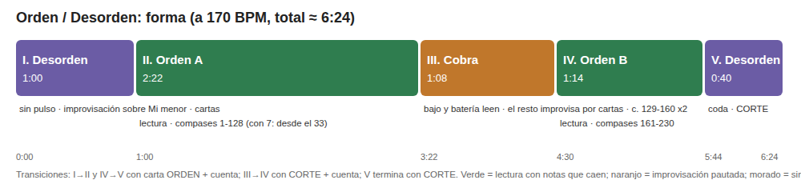

# T1: Propuesta de obra: *Orden / Desorden*

**Alvaro** · IEE2003 Orquesta de Laptops UC · 2.º semestre 2026 · Prof. Rodrigo F. Cádiz

| | |
| --- | --- |
| **Material sonoro (web)** | [`material/index.html`](material/index.html): estación para tocar. Documentación en [`material/README.md`](material/README.md) |
| **Render (75 s)** | [`material/render/orden-desorden-render.mp3`](material/render/orden-desorden-render.mp3) · [WAV](material/render/orden-desorden-render.wav) · [qué suena en cada momento](material/render/render-log.txt) |
| **Cartas del director** | [`cartas-imprimibles.html`](cartas-imprimibles.html) (8 cartas A4 para imprimir) |
| **Prototipo y herramienta de ensayo** | App de escritorio en la raíz del repositorio ([`../README.md`](../README.md)) |

**En una frase:** la orquesta toca **en vivo, tecla por tecla**, una reinterpretación del tema *Order* (Heaven Pierce Her, del videojuego ULTRAKILL). Hay secciones donde cada estación **lee** su pista con notas que caen y secciones donde **improvisa** sobre la armonía real del tema, dirigida con cartas.

---

## Parte 1: Contexto y referentes

### 1. *CliX*, Ge Wang (2006), para Princeton Laptop Orchestra (PLOrk), también en el repertorio de SLOrk

**Qué hace.** Cada intérprete teclea en su laptop. Según la ficha de SLOrk, «cada tecla del teclado del computador (mayúsculas, minúsculas, números, símbolos) corresponde a una altura distinta (usando su representación ASCII)». Al presionarla, emite un clic «sincronizado en el tiempo con un pulso común». La idea musical es que **escribir es tocar**: el gesto cotidiano de teclear se vuelve un instrumento colectivo. En palabras de la obra, las personas teclean y las máquinas sintetizan, sincronizan y espacializan el audio. Se estrenó en mayo de 2006 en *PLOrk in the Round* (Princeton). La página de Ge Wang la describe «para 15 laptops».

**Cómo está construida.**
- **Técnica:** está escrita en ChucK (el código se publica en la ficha de la obra).
- **Coordinación:** la máquina sincroniza cada clic a un pulso común, así que el intérprete decide *qué* y *cuándo aproximadamente*, no la precisión rítmica. Además hay un **director humano** que «coordina registro, textura, movimiento y tiempo».
- **Roles:** todos tocan el mismo instrumento; se diferencian por lo que el director les pide.
- **Contexto técnico del ensamble** (según el artículo de PLOrk de 2006): cada estación era un «meta-instrumento» con su propio parlante hemisférico de seis canales, y la red inalámbrica sincronizaba con 30 a 40 ms de latencia, «lo mismo o menos que la latencia acústica de un lado al otro de la orquesta».

**Qué tomo y qué no.**
- **Tomo el teclado como instrumento:** en mi obra la única interfaz es el teclado del computador, que es la interfaz garantizada del ensamble.
- **Tomo el director humano** que controla densidad y registro: en *Orden / Desorden* lo hace con cartas.
- **No tomo la sincronización automática al pulso.** En CliX la máquina alinea el ritmo; aquí el ritmo lo pone la persona, porque la obra quiere que se toque de verdad y que se note quién se adelanta. Además la red no está garantizada.
- **No tomo el mapeo ASCII:** mis teclas están ordenadas de grave a agudo como un teclado de piano, para que se puedan leer.

**Fuentes consultadas.**
- SLOrk, ficha de la obra: [slork.stanford.edu/works/clix](https://slork.stanford.edu/works/clix).
- G. Wang, página de investigación en Princeton: [cs.princeton.edu/~gewang/research](https://www.cs.princeton.edu/~gewang/research/).
- D. Trueman, P. Cook, S. Smallwood y G. Wang, «PLOrk: The Princeton Laptop Orchestra, Year 1», ICMC 2006: [PDF en el archivo de SLOrk](https://slork.stanford.edu/readings/vault/2006-icmc-plork.pdf).
- Grabación de PLOrk en Vimeo: [vimeo.com/197854007](https://vimeo.com/197854007).

### 2. *Cobra*, John Zorn (1984): improvisación dirigida por cartas

**Qué hace.** Es una *game piece*: un sistema de reglas muy detalladas sin una secuencia de eventos fija. Un grupo de improvisadores (idealmente diez o más, según Zorn) produce una música que cambia radicalmente de una función a otra. No hay notación musical tradicional.

**Cómo está construida.**
- **Director:** un *prompter* muestra **cartas con indicaciones**. Por ejemplo, la carta «XP» ordena un intercambio: los que tocan paran y los que callaban entran. Otras cartas forman subgrupos, piden imitar a otro músico o desarrollar el material que está sonando.
- **Participación de los músicos:** piden cambios al prompter con **gestos** o con señales en la cabeza. Pueden formar «unidades guerrilla», que se saltan temporalmente al prompter.
- **Forma y reparto:** la forma nace del juego; la cantidad de músicos, la instrumentación y la duración son indeterminadas.
- **Historia:** se estrenó en Roulette (Nueva York) en 1984 y existen grabaciones de estudio de 1985 y 1986.

**Qué tomo y qué no.**
- **Tomo el mecanismo de cartas** y dos de sus funciones documentadas: el intercambio (XP) y la imitación, que en mi obra es la carta ECO. Las demás (SOLO, DÚO, CAPAS, CORTE, ORDEN) son cartas propias hechas con esa lógica. Las cartas coordinan sin red, sin reloj y sin partitura.
- **Tomo la idea de que la forma de la sección III la decide el director en vivo.**
- **No tomo la libertad total de material:** en *Cobra* cada músico toca lo que quiere, mientras que aquí las teclas **solo dan notas del acorde del compás**, y bajo y batería mantienen el tema. Así la improvisación es viable para personas no virtuosas y con poco ensayo, como pide el enunciado.
- **No tomo las unidades guerrilla ni los pedidos desde los músicos.** Aumentan la complejidad del reglamento y quedan como posible extensión.

**Fuentes consultadas.**
- «Cobra (Zorn)», Wikipedia: [en.wikipedia.org/wiki/Cobra_(Zorn)](https://en.wikipedia.org/wiki/Cobra_(Zorn)).
- L. Tusman, «Notes and notations on John Zorn's Cobra game piece»: [leetusman.com/archive/cobra](https://leetusman.com/archive/cobra/). Hay copia en [archive.org](https://archive.org/details/john-zorn-cobra). De aquí se tomó la definición general (cartas, reglas y prompter); los detalles de XP, las unidades guerrilla, el estreno y las grabaciones vienen de Wikipedia.

### 3. *Guitar Hero* (Harmonix/Neversoft) y *Rock Band* (Harmonix): la "autopista" de notas como notación

**Qué hace.** Son videojuegos en que una canción de banda se reparte entre jugadores. En *Rock Band* son cuatro, con guitarra, bajo, batería y voz. Cada jugador ve su parte como **notas de colores que bajan por la pantalla** y presiona el botón correspondiente cuando llegan. Si falla, **se silencia su pista** de la grabación. Esta descripción es del funcionamiento conocido de los juegos, no de una fuente académica. Kiri Miller (2009) los estudia como **interpretación musical colaborativa**; según el resumen de su artículo, analiza la frontera entre interpretación «virtual» y «real» y lo que los jugadores entienden por «musicalidad genuina».

**Cómo está construida.**
- **Notación:** la notación es temporal y espacial a la vez (el tiempo es la distancia a la línea) y no requiere saber leer música.
- **Reparto:** cada rol corresponde a una pista del arreglo.
- **Coordinación:** es total, porque la grabación es el reloj.

**Qué tomo y qué no.**
- **Tomo la notación por notas que caen** para las secciones de lectura. El MIDI de la obra se convierte automáticamente en la partitura de cada estación, y cualquier integrante del curso la entiende en minutos.
- **Tomo el reparto de la canción por pistas.**
- **No tomo la grabación de fondo:** en mi obra **cada sonido lo produce una tecla presionada**. Si alguien no toca, esa voz no existe. Así la obra se ubica del lado «real» de la frontera que plantea Miller: tocar, no acompañar una grabación.
- **No tomo la evaluación por puntaje.**

**Fuente consultada.** K. Miller, «Schizophonic Performance: *Guitar Hero*, *Rock Band*, and Virtual Virtuosity», *Journal of the Society for American Music* 3(4), 2009, pp. 395-429. DOI [10.1017/S1752196309990666](https://www.cambridge.org/core/journals/journal-of-the-society-for-american-music/article/abs/schizophonic-performance-guitar-hero-rock-band-and-virtual-virtuosity/87327008319F70A4E56E4D5DF7CE6C0D). Se consultó el resumen.

---

## Parte 2: Propuesta de obra

### 2.1 Título provisorio e idea

***Orden / Desorden*.** Una banda de laptops toca en vivo una reinterpretación propia del tema *Order*. El material es un MIDI de 12 pistas transcrito y personalizado por mí: cuerdas, coro, piano, bajo, guitarras distorsionadas y batería. Cada estación es un instrumento de esa banda y lo toca con su teclado, nota por nota.

La obra alterna dos estados:

- **Orden:** cada estación **lee** su pista con notas que caen, al estilo de *Rock Band*.
- **Desorden:** las mismas teclas se convierten en **notas del acorde vigente** y el ensamble **improvisa** bajo la dirección de cartas, como en *Cobra*.

Como en *CliX*, el teclado es el instrumento y un director da forma a la textura. La diferencia es que aquí **nadie reproduce nada**: si una estación calla, esa voz desaparece del tema. La pregunta de la obra es cuánto de una canción sobrevive cuando la tocan personas que tienen que escucharse para sostenerla.

### 2.2 Estructura formal

| Sección | Duración (a 170 BPM) | Qué sucede | Transición |
| --- | --- | --- | --- |
| **I. Desorden** (entrada) | ≈ 1:00 | Sin pulso. Las teclas de todas las estaciones dan notas de **Mi menor** en su registro. Hay notas largas y pocas. El director construye la textura con CAPAS (entradas de grave a agudo) y SOLO/DÚO. | El director muestra **ORDEN** y cuenta con la mano; todos presionan Enter en el "ya", la pantalla cuenta un compás y empieza la II. |
| **II. Orden A** | ≈ 2:22 (con 7: ≈ 1:45) | Lectura de los **compases 1-128**: introducción de cuerdas, entrada de la banda completa en el 33 y desarrollo en Mi menor. | Sin corte: el director muestra la carta de la III durante el compás 128. |
| **III. Cobra** | ≈ 1:08 (compases 129-160, dos veces) | **Bajo y batería siguen leyendo**, así que el tema se sostiene. El resto **improvisa**: sus teclas cambian compás a compás a las notas del acorde (Sol menor, Do menor, Mi bemol...). El director decide la forma con cartas (TUTTI, SOLO, DÚO, XP, ECO, CAPAS). | **CORTE** en el último compás: un compás de silencio, cuenta del director y comienza la IV. |
| **IV. Orden B** | ≈ 1:14 | Lectura de los **compases 161-230**: el giro a Fa y Re bemol mayor, la vuelta a Mi menor y el final. | En el compás 230 todos sostienen la última nota. El director muestra ORDEN y, al soltar, empieza la V. |
| **V. Desorden** (coda) | ≈ 0:40 | Sin pulso y cada vez menos notas, sobre Mi menor. | **CORTE** termina la obra. |

- **Total:** ≈ 6:25 a 170 BPM con 9 o más intérpretes, y ≈ 5:45 con 7. En ensayo se puede bajar el tempo: a 140 BPM la obra completa dura unos 7:25 y sigue dentro del rango de 4 a 10 minutos.
- **Con 7 intérpretes,** la sección II empieza en el compás 33, porque la introducción (compases 1-32) la tocan cello, violín y coro. La sección I cumple esa función.

### 2.3 Estrategia de coordinación

La coordinación es **humana y visual, sin red**. Hay tres niveles:

1. **Reloj por sección, no por obra.** Cada sección con pulso (II, III y IV) **arranca de nuevo con una cuenta del director**: gesto de "3, 2, 1, ya" y todos presionan Enter. La estación da un compás de cuenta en pantalla y empieza desde el compás de esa sección. Un error de arranque de ±50 a 100 ms solo dura hasta la siguiente sección.
2. **Durante la sección, la referencia es el oído.** La **batería (tambores) es el reloj audible**: el resto la sigue, como en una banda. La pantalla guía, pero no manda. Si una estación nota que su pantalla va corrida respecto de la banda, corrige con **← / →** (±30 ms por toque).
3. **Las cartas dan forma a la improvisación.** Valen **desde el 1 del compás siguiente** a que se muestran. El director las muestra impresas en A4 ([cartas](cartas-imprimibles.html)) o proyectadas desde su estación en modo *Director*. Para SOLO, DÚO y ECO, señala a la estación con la mano o la elige en el campo *para*.

**Red (opcional, no implementada, no necesaria).** Si en noviembre hay red estable, la estación del director enviaría por OSC/UDP, siguiendo la línea del protocolo `/oluc` del curso:

| Mensaje | Cuándo | Qué hace la estación que lo recibe |
| --- | --- | --- |
| `/oluc/orden/seccion i` | Al dar la cuenta | Arranca la sección *i* sin presionar Enter |
| `/oluc/orden/compas n` | En el 1 de cada compás | Corrige su reloj si difiere más de 60 ms |
| `/oluc/orden/carta NOMBRE estacion` | Al mostrar una carta | La muestra en la pantalla de todos |

- **Quién envía y quién recibe:** envía solo el director; reciben todas las estaciones.
- **Si se pierde un mensaje:** no pasa nada. La estación sigue con su propio reloj, y la carta física sigue a la vista.
- **Puente para el navegador:** la versión web necesitaría un puente OSC a WebSocket (por ejemplo, un script de Node en la estación del director).
- **Sin red,** la obra se ejecuta **exactamente como se describe arriba**, que es la versión principal.

### 2.4 Roles por estación

Cada estación tiene **algo que ejecutar en tiempo real**: en lectura, tocar su pista a tiempo; en improvisación, decidir cuándo, cuánto y qué nota del acorde tocar. El dato *notas por segundo* es el promedio de la pista en el tema.

**Núcleo de 7:**

| # | Estación | Lectura (II y IV) | Improvisación (I, III y V) | Dificultad |
| --- | --- | --- | --- | --- |
| 1 | **Batería: tambores** (bombo, bombo 2, caja, toms) | Pulso de la banda; es el reloj audible | En la III lee, pero **decide los rellenos**: en el compás anterior a cada cambio de carta toca toms libres. Con **Tab** puede pasar a tocar libre durante un SOLO. En I y V: golpes aislados, toms | Alta (8,8 notas/s) |
| 2 | **Bajo** | Fundamentales | En la III lee, pero **decide cuándo dejar el tema**: con **Tab** sus teclas pasan a notas del acorde (por ejemplo, un pedal en la fundamental bajo un SOLO) y con Tab vuelve a leer. En I y V: notas pedal | Media (2,7 notas/s) |
| 3 | **Guitarra rítmica** | Riffs graves | Acordes y *palm*: varias teclas juntas, en corcheas | Media-alta (4,5 notas/s) |
| 4 | **Guitarra 2 + solista** | Las dos guitarras del MIDI unidas, porque se turnan (solo del compás 166 al 197) | Voz principal de los SOLO | Media (2 notas/s) |
| 5 | **Orquesta de cuerdas** | Colchón armónico | Notas largas, una por acorde; mantener la nota común | Baja (1,2 notas/s) |
| 6 | **Violín** | Melodía de cuerdas | Respuestas melódicas en DÚO y ECO | Baja (1,1 notas/s) |
| 7 | **Piano + dirección** | Pocas notas (0,4 notas/s), por eso lleva la dirección: cuenta y cartas | Muestra las cartas; toca arpegios cuando no está dirigiendo | Baja al tocar; la carga es dirigir |

**Estaciones 8 a 12** (se suman en este orden):

| # | Estación | Aporta |
| --- | --- | --- |
| 8 | **Batería: platillos** (hi-hat, ride, campana, crash) | La mitad de la batería. Con ella, los tambores quedan más livianos |
| 9 | **Cello** | Junto al violín permite empezar la sección II desde el compás 1 |
| 10 | **Coro** | Notas largas; en la I y la V es la voz más expuesta |
| 11 | **Cuerdas trémolo 2** | Textura de trémolo en la II y la IV |
| 12 | **Cuerdas trémolo** | La segunda capa de trémolo |

Si hay 8 o más intérpretes, la **dirección puede pasar a una persona dedicada**, por ejemplo el profesor o el ayudante, como el *prompter* de *Cobra*. En ese caso, el piano solo toca.

### 2.5 Notación e instrucciones de ejecución

- **Secciones de lectura (II y IV):** la notación es la **pantalla de notas que caen** de cada estación, generada del MIDI (ver [imagen](img/estacion-lectura.png)). Cada columna es una tecla, de grave (izquierda) a agudo (derecha). La nota se toca cuando su borde inferior toca la línea blanca, y el largo del bloque es cuánto se mantiene.
- **Secciones de improvisación (I, III y V):** la pantalla muestra el **compás, el acorde actual y el siguiente**. Bajo cada tecla muestra la nota que da y su función en el acorde (R, b3, 5, 7...). Ver [imagen](img/estacion-improvisacion.png).
- **Instrucciones escritas y cartas:** ver [cartas](cartas-imprimibles.html) e [imagen del modo director](img/director-cartas.png).

**Boceto completo de la sección III, «Cobra»** (compases 129-160, dos pasadas, ≈ 1:08 a 170 BPM):

> **Antes de empezar (compás 128):** el director muestra **TUTTI**.
>
> **Reglas de la sección**
> - Bajo y batería **leen** su pista, que es el suelo de la sección. Solo obedecen **CORTE**. Durante un SOLO o un DÚO pueden pasar a tocar libre con **Tab** (el bajo, con notas del acorde) y deben volver a leer con el siguiente TUTTI. La batería decide los rellenos antes de cada cambio de carta.
> - El resto **improvisa** en modo improvisación: sus teclas son las notas del acorde del compás. Guía por instrumento:
>   - cuerdas y coro: una nota por compás;
>   - piano: arpegios en negras;
>   - guitarra rítmica: acordes (2 o 3 teclas juntas) en corcheas;
>   - guitarra 2 + solista: frases, máximo 2 compases seguidos.
> - Una carta vale **desde el 1 del compás siguiente** a que aparece y hasta que cambia.
> - **Nadie toca más fuerte que la batería.** Si no escuchas el bombo, estás tocando demasiado.
>
> **Recorrido de referencia** (primera pasada; en la segunda, el director elige libremente)
>
> | Compases | Carta | Quién | Carácter |
> | --- | --- | --- | --- |
> | 129-136 | TUTTI | Todos | Densidad media: cada uno toca en la mitad de los pulsos o menos |
> | 137-144 | SOLO → Guitarra 2 + solista | Solo la guitarra, sobre bajo y batería | Frases que suben; el resto calla |
> | 145-152 | XP | Entran los que callaban: cuerdas, coro, piano, violín | La guitarra calla; notas largas y cambios de acorde marcados |
> | 153-160 | DÚO → Violín + Guitarra rítmica | Pregunta de un compás, respuesta de un compás | Termina con los dos juntos en el 160 |
> | 2.ª pasada | Cartas a elección del director (sugerido: ECO → CAPAS → TUTTI) | | Crescendo hacia el final |
> | Último compás (160) | **CORTE** | Todos, también bajo y batería | Silencio; cuenta del director y entra la IV en el 161 |

### 2.6 Sonido en la sala

Cada estación suena **por su propio parlante**. No hay mezcla central; la mezcla es la sala, como en PLOrk y SLOrk.

**Disposición:** en semicírculo, como una banda vista desde el público.
- Centro atrás: tambores y platillos, con el bajo al lado.
- Izquierda: las guitarras.
- Derecha: las cuerdas y el coro.
- Adelante al centro: el piano y la dirección, mirando al ensamble. Así el público ve de dónde sale cada voz y oye cómo se desplaza el protagonismo en la sección III.

**Con los parlantes hemisféricos** (especulativo, porque están en construcción), la estación web sale en estéreo. Una extensión simple es repartir la salida de las estaciones de cuerdas y trémolo entre los canales disponibles, para que el trémolo se mueva en el espacio. La batería y el bajo usarían un solo canal, para que el pulso venga de un lugar fijo. Si los parlantes no están listos, cada estación usa los de su laptop o un monitor pequeño, y el balance se ajusta con *Mi volumen* en el ensayo.

### 2.7 Riesgos y versión reducida

| Riesgo (de más a menos probable) | Qué se hace |
| --- | --- |
| **Leer a 170 BPM es difícil**, sobre todo la batería (8,8 notas/s) y la guitarra rítmica (4,5 notas/s) | Ensayar a 120-140 BPM (control *BPM*). Si no alcanza, la batería pasa a improvisar un pulso simple en las secciones II y IV (bombo en 1, caja en 2 y 3) y deja de leer. |
| **Desfase entre estaciones** (cada una con su reloj) | El arranque se rehace en cada sección, la batería es la referencia audible y cada estación corrige con ← / →. En el peor caso, la estación se guía solo por el oído. |
| **Latencia del navegador en Windows** (20-50 ms) | Usar Chrome o Edge. Si la latencia molesta, esa estación usa la app de escritorio del repositorio (audio WASAPI, de menor latencia), que tiene los mismos instrumentos y teclas. |
| **Teclados que no registran 3 o más teclas a la vez** (*ghosting*) | Casi todos los roles tocan una nota a la vez. La guitarra rítmica prueba sus acordes en su laptop en el primer ensayo. |
| **Cartas mal leídas** | Cartas A4 grandes, más la proyección de la estación del director. Solo 8 cartas, ensayadas una por una. |
| **Parlantes no disponibles** | Salida de la laptop más un monitor por estación. |

**Versión reducida:** 7 estaciones, **solo las secciones I, III y V**, a 130 BPM, con la III tres veces: ≈ 1:00 + 2:13 + 0:40 ≈ 3:55. Bajo y batería leen los compases 129-160 (o improvisan un pulso simple) y el resto improvisa por cartas sobre esa armonía. No hay lectura difícil ni red, y las teclas no permiten notas fuera del acorde, así que funciona aunque falle todo lo demás.

---

## Parte 3: Material sonoro

### Material funcional: estación web

**[`material/`](material/)** contiene una página web con Web Audio API, sin librerías, que se abre con doble clic. La documentación completa está en **[`material/README.md`](material/README.md)**: entorno, versión, parámetros, cómo reproducir el render y cómo modificarla.

- **Qué hace:** es el instrumento de cada estación de la obra.
  - **Lectura:** notas que caen, en las 12 pistas.
  - **Improvisación:** las teclas dan las notas del acorde de cada compás, en el registro del instrumento.
  - **Director:** cartas en grande.
  - Incluye las cinco secciones de la obra, tempo ajustable y el modo *Fondo* para ensayar solo.
- **Render:** [`orden-desorden-render.mp3`](material/render/orden-desorden-render.mp3) ([WAV](material/render/orden-desorden-render.wav)), de **75 s**. Lo produce el botón *Render* de la misma página, con `OfflineAudioContext` y la misma síntesis que en vivo. Recorre la obra en miniatura: Desorden → lectura de los compases 33-48 → Cobra con cartas TUTTI, SOLO y XP → CORTE → lectura de los compases 161-176. Las improvisaciones del render las toca un intérprete simulado con semilla fija; en concierto las tocan personas.
- **Papel en la obra:** la usan **todas las estaciones**, cada una con su pista, y el director en modo cartas. Lo más representativo es el cambio de *leer* a *improvisar* de la sección III: la misma estación y las mismas teclas, con otro significado.
- **Cómo se probó:** en Chromium 141 (Linux), abriendo cada modo, presionando teclas y produciendo el render dos veces. Los dos archivos coinciden salvo diferencias de redondeo de 1 bit.

### Parte conceptual (aún no implementada)

- **Unidades guerrilla:** dos o tres estaciones que, levantando la mano, cambian su modo a *lectura* durante 4 compases dentro de la sección III, citando literalmente la pista original encima de la improvisación. Sería un botón en la estación que activa la lectura solo hasta el siguiente compás múltiplo de 4.
- **Sincronización por red:** los tres mensajes OSC de la sección 2.3, con un puente de Node (UDP a WebSocket) en la estación del director. La estación corregiría su reloj solo si el error supera 60 ms, desplazando gradualmente 5 ms por compás para que no se oiga el salto.
- **Espacialización del trémolo:** en parlantes hemisféricos de *n* canales, cada nota de trémolo saldría por un canal distinto en rotación, un paso por cada ciclo del LFO de 12 Hz.

---

## Declaración de uso de IA

- **Herramienta:** Claude (Anthropic), en la app de escritorio de Claude (modo Cowork), configurado con el modelo `claude-opus-5-5`. Tenía acceso a mi carpeta del curso y a búsqueda web.
- **Para qué la usé:**
  1. Programar la app de escritorio (Python/Tkinter/numpy/sounddevice/mido): síntesis, lectura del MIDI, notas que caen, modos manual y automático, mezcla de la banda, división de la batería y unión de las guitarras.
  2. Programar la estación web de la Parte 3 y su render.
  3. Analizar el MIDI (tonalidad, compás, acordes y actividad de cada pista).
  4. Proponer y verificar referentes: *Cobra* y *Rock Band* los propuso Claude; *CliX* lo elegí yo. Claude consultó las fuentes enlazadas en la Parte 1, y un segundo agente de Claude contrastó cada dato citado con ellas.
  5. Redactar un primer borrador de este documento, incluida la estructura, los roles y las cartas, a partir de la app y de mis indicaciones.
- **Qué es mío:**
  - la elección del tema y la idea de tocarlo en vivo, con partes improvisadas;
  - la **transcripción y reinterpretación del MIDI de *Order***, que es personalizada, no exacta;
  - las decisiones de diseño de la app, por ejemplo teclas en orden de teclado, menús simples, modo automático para practicar, separar la batería, unir guitarra 2 y solista, y dar más volumen al trémolo;
- **Prompts relevantes** (extractos textuales de mis mensajes):
  - «Qué obras conoces de orquesta de laptops… que se pueda improvisar»; «quiero que la primera como ejemplo sea CliX».
  - «quiero proponer una obra como una canción de un grupo»; «quiero que sea en tiempo real, y que se deba realmente tocar música».
  - «crea una app para Linux Mint/Windows… tocar instrumentos con el teclado».
  - «Tocar instrumento… una opción de tocar automáticamente… un tempo a elegir».
  - «crea una visual de cómo vienen las notas… dos modos de tocar, auto y manual; auto es para practicar».
  - «sepárala en tambores y en platillos»; «agrega un listen full de todas juntas… proof of concept»; «mezclar la guitarra 2 con la guitarra solista».
  - «me ayudas a terminar mi tarea 1… documentación en base a la obra… que podían improvisar, y sigue las instrucciones de la Tarea». A partir de este pedido, Claude propuso los referentes, la forma en cinco secciones, las cartas y la versión web del material, porque el enunciado solo acepta Max, Pd, ChucK o web.

---

## Guion de la presentación (5 min, desde este documento)

| Tiempo | Qué muestro |
| --- | --- |
| 0:00-1:00 | **Idea y referentes.** La frase inicial. *CliX*: el teclado como instrumento y un director. *Cobra*: cartas para improvisar. *Rock Band*: notas que caen como partitura, pero aquí sin grabación de fondo. |
| 1:00-3:00 | **Estructura y coordinación.** Diagrama de la forma. Cómo se arranca cada sección (cuenta y Enter) y por qué la batería es el reloj. Boceto de la sección III con las cartas. Roles para 7 y cómo se llega a 12. |
| 3:00-4:00 | **Material sonando.** Abro `material/index.html`: toco una estación en lectura, cambio a la sección III y toco en improvisación (las teclas cambian con el acorde). Pongo 20 s del render desde 0:31 (TUTTI, SOLO, XP). |
| 4:00-5:00 | **Riesgos y preguntas al curso.** ¿170 BPM o 140? ¿Quién dirige: una persona dedicada o el piano? ¿Montamos primero la versión reducida (I, III, V)? |
