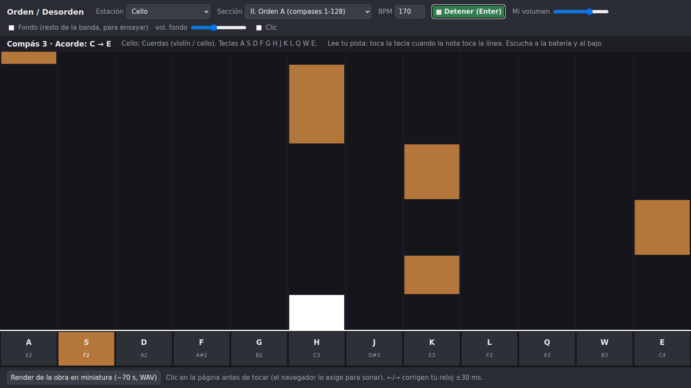

# Material sonoro: estación web de *Orden / Desorden*

Una página web con Web Audio API y sin librerías externas. Cada laptop del ensamble la abre, elige su **estación** (un instrumento de la banda) y toca **con el teclado del computador**. Tiene tres modos:

- **Lectura:** las notas de tu pista caen hacia una línea, sobre un teclado dibujado. Presionas la tecla cuando la nota llega a la línea.
- **Improvisación:** tus teclas cambian solas a las notas del acorde del compás actual, en el registro de tu instrumento. No hay nota "equivocada": decides cuándo, cuánto y qué nota del acorde tocar.
- **Director:** muestra en grande la carta de improvisación (TUTTI, SOLO, XP, CORTE, etc.) para proyectarla o mostrarla al ensamble.

La página también produce el **render** de la obra en miniatura (unos 75 s), con el mismo código de síntesis.

## Entorno y versión

- **Entorno:** web (HTML y JavaScript con **Web Audio API**). No usa librerías, servidor ni conexión a internet.
- **Navegador:** probado con **Chromium 141** (Playwright 1.56, Linux). Debería andar igual en Chrome o Edge 120+ en Windows 10 y Linux, y en Firefox 120+. El render se probó solo en Chromium.
- **Cómo abrirla:** doble clic en `index.html`. Funciona desde el archivo (`file://`) porque los datos van en `order-data.js`, no en un JSON que haya que descargar.
- Los navegadores exigen un clic en la página antes de sonar.

## Archivos

| Archivo | Qué es |
| --- | --- |
| `index.html` | La página: controles, lienzo de notas y botón de render |
| `synth.js` | Síntesis (clase `Synth`), generador de azar con semilla (`makeRng`) y exportación a WAV |
| `app.js` | Estación: la obra (secciones y cartas), teclado, reloj, modos, dibujo y `renderDemo()` |
| `order-data.js` | Datos de la obra sacados del MIDI: 12 pistas con sus teclas, compases, pulsos y acordes |
| `export_data.py` | Regenera `order-data.js` desde `songs/Heaven Pierce Her - ORDER.mid`. **Necesita el repositorio completo**: usa `song.py`, `profiles.py` e `instruments.py` de la raíz, y Python 3.10+ con `mido` y `numpy` |
| `render_headless.py` | Opcional: produce el render sin abrir el navegador (Playwright) |
| `render/` | `orden-desorden-render.wav` (48 kHz, 16 bits, estéreo), `.mp3` y `render-log.txt` (qué pasa en cada segundo) |

## Cómo hacerla sonar

1. Abre `index.html` y haz clic en la página.
2. **Estación:** elige tu instrumento. Son 12: Batería: tambores, Batería: platillos, Bajo, Guitarra rítmica, Guitarra 2 + solista, Piano, Cello, Violín, Orquesta de cuerdas, Cuerdas trémolo, Cuerdas trémolo 2 y Coro. También está **Director (cartas)**.
3. **Sección:** elige la parte de la obra (I a V). La sección decide el modo: lectura (II, IV) o improvisación (I, III, V).
4. Toca **Enter** o presiona *Empezar*. Hay un compás de cuenta con clic y después empieza a correr el reloj de la obra.
5. Toca con tus teclas, que se ven abajo en la pantalla. Van de grave (izquierda) a agudo (derecha): primero A S D F G H J K L y después Q W E R T Y U I O P.
6. **Si te desfasas** de la banda, **← / →** corren tu reloj 30 ms antes o después.
7. **Bajo y batería en la sección III:** leen por defecto. **Tab** alterna entre leer e improvisar; la pantalla dice LEER o IMPROVISAR.

## Qué controla cada parámetro

| Control | Efecto |
| --- | --- |
| **Estación** | Qué pista del MIDI lees y con qué timbre suenas. Cada tecla da una nota fija: las 19 notas que esa pista más usa, de grave a agudo. En la batería, cada tecla es una pieza. |
| **Sección** | I y V: sin pulso, las teclas dan Mi menor. II: compases 1-128, lectura. III: compases 129-160 dos veces, improvisación sobre los acordes. IV: compases 161-230, lectura. |
| **BPM** | Tempo de todo, desde 60 hasta 220; el original es 170. Los cambios de tempo del MIDI se escalan en la misma proporción. |
| **Mi volumen** | Tu volumen, de 0 a 150 %. |
| **Fondo** y **vol. fondo** | Para ensayar solo: la página toca las otras 11 pistas a este volumen. En la sección III solo toca el bajo y la batería. **En concierto va apagado.** |
| **Clic** | Metrónomo durante la sección. La cuenta inicial siempre suena. |
| **Cartas 1-8** y **para** | Solo para el director: carta y estación a la que va dirigida. |
| **Render** | Calcula la obra en miniatura, la muestra en un reproductor y descarga `orden-desorden-render.wav`. |

## Cómo reproducir el render

- **Desde el navegador:** abre `index.html` y presiona **Render de la obra en miniatura**. Tarda unos segundos y descarga `orden-desorden-render.wav` (75,2 s).
- **Sin abrir el navegador a mano:** `pip install playwright`, `playwright install chromium` y `python render_headless.py`.

El render usa `OfflineAudioContext` y las mismas clases que la estación en vivo. Las partes improvisadas las toca un **intérprete simulado con semilla fija** (`makeRng(7)`), que camina por las notas del acorde con el ritmo típico de su instrumento. Por eso dos renders salen iguales: en la prueba, dos corridas difirieron como máximo en 1 bit de redondeo. En concierto, esas partes las tocan personas.

**Contenido del render** (según `render-log.txt`):

| Tiempo | Qué suena |
| --- | --- |
| 0:00 | **I. Desorden**: coro, cuerdas y piano, notas largas de Mi menor sin pulso. |
| 0:10 | **Orden**: las 12 estaciones leen los compases 33-48. |
| 0:31 | **III. Cobra**: compases 129-152; el bajo y la batería leen. |
| 0:31 | Carta TUTTI: dos guitarras, piano, orquesta y coro improvisan. |
| 0:39 | Carta SOLO: guitarra 2 + solista. |
| 0:48 | Carta XP: la guitarra calla y entran piano, orquesta, coro y violín. |
| 0:56 | Carta CORTE: silencio. |
| 0:57 | **Orden**: lectura de los compases 161-176 (el cambio a Fa mayor). |

## Cómo modificarla

- **Otra canción:** cambia `MIDI` en `export_data.py`, córrelo desde la carpeta de la app y ajusta `SECTIONS` en `app.js` (compases de cada sección y acorde de las partes sin pulso).
- **Timbres:** en `Synth.note()` (`synth.js`) cada timbre es un bloque `if`. El volumen relativo de cada uno está en `SOUNDS[...].level`. La batería se genera en `_buildDrums()`: por ejemplo, el ride es una suma de 40 modos inarmónicos más el golpe del palillo.
- **Cartas:** en la lista `CARDS` de `app.js` y en `../cartas-imprimibles.html`.
- **Qué notas da cada tecla al improvisar:** `improvNotes()` en `app.js` toma las notas del acorde dentro del registro real de la pista (del percentil 5 al 95 de sus notas).
- **Render:** `RENDER_PLAN` en `app.js` define los fragmentos, las cartas y quién improvisa.

## Síntesis (resumen preciso)

- **Guitarra:** dos sierras desafinadas ±7 cents y una cuadrada una octava abajo, con distorsión `tanh` (drive 9, oversample 2x), paso bajo a 3,4 kHz y un realce de 4 dB en 1,4 kHz. Ataque de 4 ms y caída de τ 2,5 s hasta el 35 %.
- **Bajo:** sierra más seno, con un paso bajo que baja de 2,2 kHz a 500 Hz (τ 80 ms) y saturación suave.
- **Piano:** fundamental en triángulo y 3 armónicos en seno que decaen antes. La cola es más larga en las notas graves.
- **Cuerdas:** tres sierras desafinadas (±6 cents; ±14 en la orquesta) con paso bajo según la nota y ataque de arco de 90 a 180 ms. Vibrato de 5,5 Hz que entra a los 0,4 s.
- **Trémolo:** las mismas cuerdas con un LFO de amplitud de 12 Hz y profundidad del 35 %.
- **Coro:** dos sierras que pasan por tres formantes de la vocal "ah" (730, 1090 y 2440 Hz), con vibrato de 5,2 Hz.
- **Batería:** golpes calculados al abrir la página, con 2 o 3 variaciones de cada pieza. El bombo es un seno que baja de 160 a 48 Hz. La caja son dos tonos más ruido. Los platillos son ruido filtrado más modos inarmónicos.
- **Master:** compresor a −16 dB con razón 4:1.

## Papel en la obra y estaciones

Esta página **es el instrumento de cada estación**: las 12 estaciones la usan, cada una con su pista, y el director la usa en modo cartas. El material más representativo de la obra es el **cambio de modo en la sección III**. La misma estación que venía leyendo pasa a improvisar sobre la armonía real del tema, y sus teclas se transforman compás a compás en notas del acorde.

## Relación con la app de escritorio

En la raíz del repositorio está la app en Python/Tkinter (`app.py`), con la que se desarrolló la idea. Es la herramienta de ensayo: modo automático, mezcla de la banda completa y edición de teclas. El enunciado permite solo Max, Pd, ChucK o web para este material, así que esta página es la versión web de su núcleo, construida para cumplir ese requisito.
